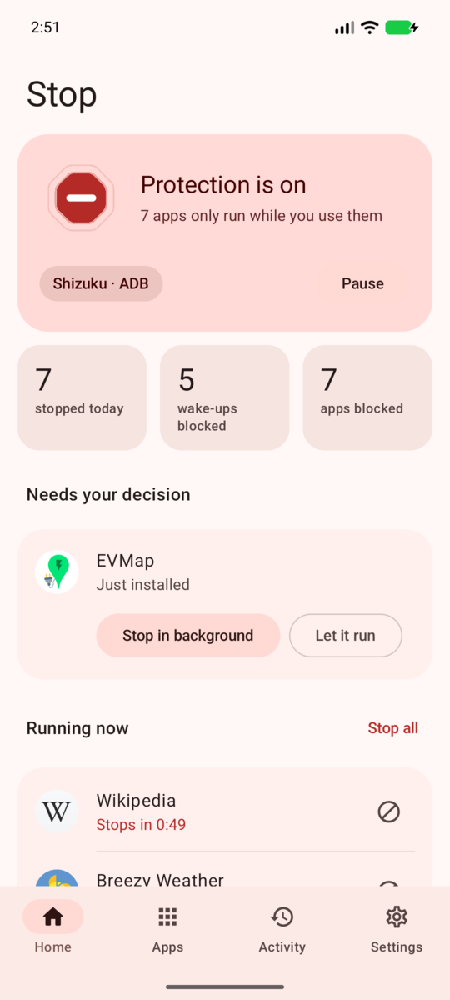
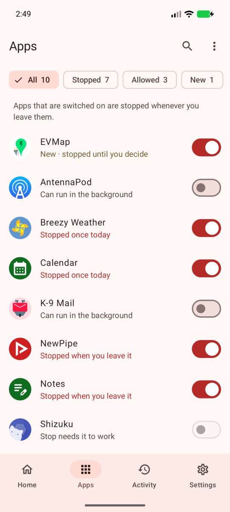
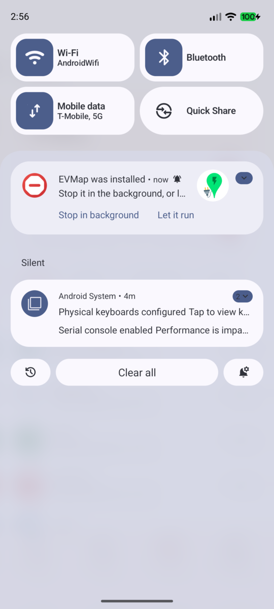
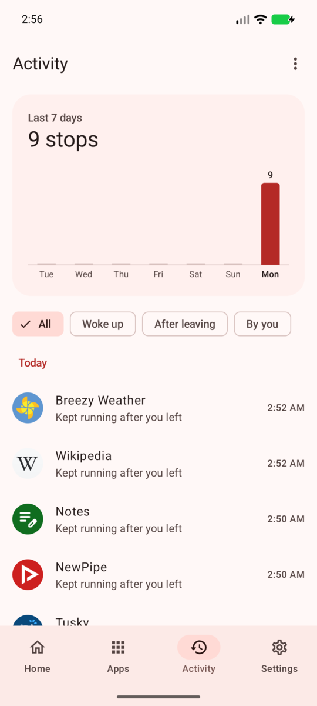
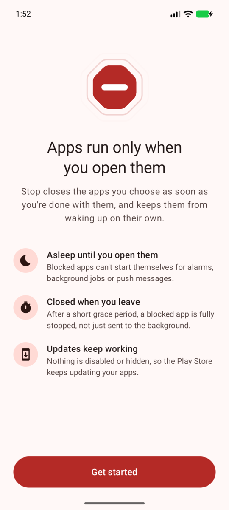
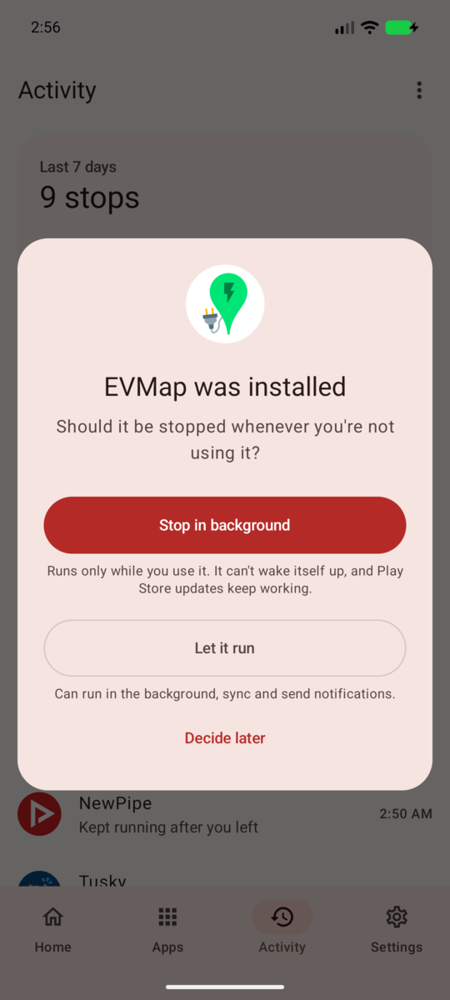
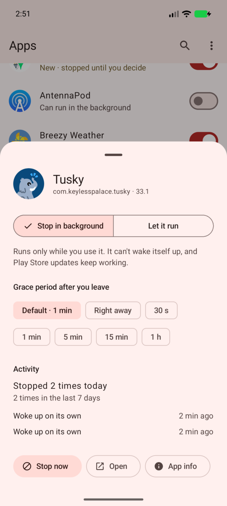
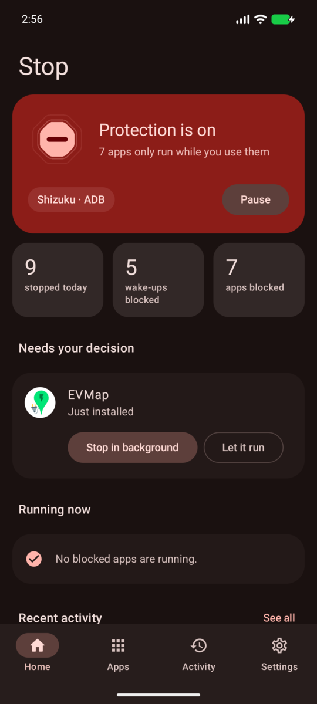

<p align="center">
  
</p>

<h1 align="center">Stop</h1>

<p align="center"><b>Apps run only when you open them.</b></p>

<p align="center">
  
  
  
  
</p>

Stop keeps the apps you choose from running in the background. A blocked app works normally while
you use it. When you leave it, Stop closes it for real after a short grace period, and it can't wake
itself up again for alarms, background jobs or push messages until you open it the next time.

It was made for a very specific annoyance: dozens of apps you rarely use (in my case, around 40 EV
charging apps) that keep waking up in the background all day.

<details>
<summary>More screenshots</summary>
<p align="center">
  
  
  
  
</p>
</details>

## Features

- **Blocked apps only run while you use them.** Leave one, and it's force-stopped after a grace
  period you choose (right away, 30 s, 1, 5 or 15 min, 1 h), for all apps or per app. Swiping an
  app away from Recents ends its grace period.
- **No sneaking back.** If a blocked app starts on its own (push message, alarm, job, another app
  poking it), Stop notices within about a second and stops it again.
- **Never in your way.** An app is left alone while it's on screen, while you're in something it
  opened (camera, file picker, a payment page), while an app on screen or Android Auto is using it,
  and while it's on top when you lock the phone.
- **Asks about every new app.** Install something and Stop asks right away whether it may run in the
  background, with *Stop in background* and *Let it run* buttons on the notification.
- **Play Store updates keep working.** Stop never disables, suspends or hides apps. Stopped apps
  are in the same state as an app you installed and never opened, which the Play Store updates as usual.
- **Activity log** of what was stopped, when and why, with a 7-day overview.
- **Quick Settings tile and launcher shortcut** to stop every blocked app at once.
- **Optional extra restrictions:** also mark blocked apps as *Restricted* in Android's battery
  settings, so they stay limited even while Shizuku isn't running.
- Material 3 design with light and dark themes and optional dynamic color.
- **No internet permission.** No analytics, no ads, nothing leaves your phone.

## How it works

Android doesn't let a normal app stop other apps. Stop uses [Shizuku](https://shizuku.rikka.app) to
run a small helper with the same rights `adb shell` has (or root, if you start Shizuku with root).
Your phone doesn't need to be rooted.

- The helper watches every app's process state through the system's process observer
  (`IUidObserver`). The system tells it about changes as they happen, so watching costs next to
  nothing.
- When a blocked app should not be running, the helper force-stops it. Force-stopping does more than
  closing: it puts the app in Android's *stopped state*. Its alarms and scheduled jobs are cancelled,
  it receives no broadcasts or push messages, and since Android 15 its pending intents are dropped
  too, until you launch it again. The stopped state survives reboots.
- New installs are noticed by checking the package manager's change counter every few seconds while
  the screen is on (a cheap call that returns nothing until a package changes). The helper then
  wakes Stop up so it can ask you.
- The helper keeps running after you close Stop, and restarts together with Shizuku.

### Compared to Samsung's "Deep sleeping apps"

Deep sleeping apps are known to stop getting Play Store updates until you open them. Stop never
changes whether an app is enabled, visible, suspended or hibernated, so updates work as before. The optional *extra restrictions* use Android's own
*Restricted* battery mode; on some phones that can make the Play Store update those apps later,
which is why it's off by default.

## Requirements

- Android 9 or newer (developed and tested on Android 17)
- [Shizuku](https://shizuku.rikka.app/download/), started through wireless debugging (Android 11+),
  a computer (adb), or root/Sui

## Install

1. Install and start [Shizuku](https://shizuku.rikka.app/guide/setup/).
2. Download the latest APK from [Releases](https://github.com/burakgon/stop/releases) and install it.
3. Open Stop, allow it in Shizuku's dialog, and pick the apps that may keep running in the
   background (messengers, mail, music, maps…). Everything else is stopped when you leave it.

### After a reboot

Without root, Shizuku has to be started again after every reboot. Until you do, blocked apps that
you haven't opened stay asleep, because Android keeps their stopped state. Stop reminds you with a
notification and picks up again by itself within a minute or two once Shizuku runs (right away if
you open Stop).

## FAQ

**Will I still get notifications from blocked apps?**
No. A stopped app can't receive push messages, which is the point. Let messengers and anything else
you need notifications from run in the background.

**What does "Let ongoing tasks finish" do?**
By default, a blocked app is stopped after the grace period even if it shows an ongoing
notification. Turn this on to keep apps alive while they play music, navigate or track a charging
session that you started.

**An app I blocked broke something.**
Some apps provide a system service: a keyboard, an accessibility service, a notification listener
for your watch, autofill, your alarms. Stop never stops the launcher, keyboards, the dialer, SMS and
clock apps, or apps running one of those services, and it leaves packages without an icon (voice
data, language packs, plugins) alone unless you choose to show system apps. If something else
broke, let that app run in the background.

**Samsung keeps putting Stop to sleep.**
Stop exempts itself from battery optimization through Shizuku. If your phone still restricts it,
add Stop to *Settings › Battery › Background usage limits › Never sleeping apps*.

**How do I uninstall it cleanly?**
Just uninstall it. The helper notices, undoes the extra battery restrictions it applied and exits.
Blocked apps simply start normally again the next time they're launched.

## Building

You need JDK 17 or newer and the Android SDK.

```sh
./gradlew assembleDebug        # debug build
./gradlew testDebugUnitTest    # unit tests
./gradlew assembleRelease      # release build
```

Release builds are signed with the key described in `keystore.properties` (not committed):

```properties
storeFile=release.jks
storePassword=…
keyAlias=…
keyPassword=…
```

Without that file, release builds fall back to the debug key. Tags named `v*` are built and
published to GitHub Releases by the workflow in `.github/workflows/android.yml`, using the
`SIGNING_*` repository secrets.

### Project layout

| Path | What's there |
| --- | --- |
| `app/src/main/java/…/daemon` | The privileged helper that runs inside Shizuku: enforcement logic (`Enforcer`), process observer, install watcher |
| `app/src/main/java/…/core` | Connecting to Shizuku and the helper, syncing settings, handling new installs |
| `app/src/main/java/…/ui` | Jetpack Compose UI |
| `app/src/main/aidl` | The interface between the app and the helper |
| `hidden-api` | Compile-only stubs for the Android framework's hidden interfaces |

## License

Stop is free software, licensed under the [GNU General Public License v3.0](LICENSE).
